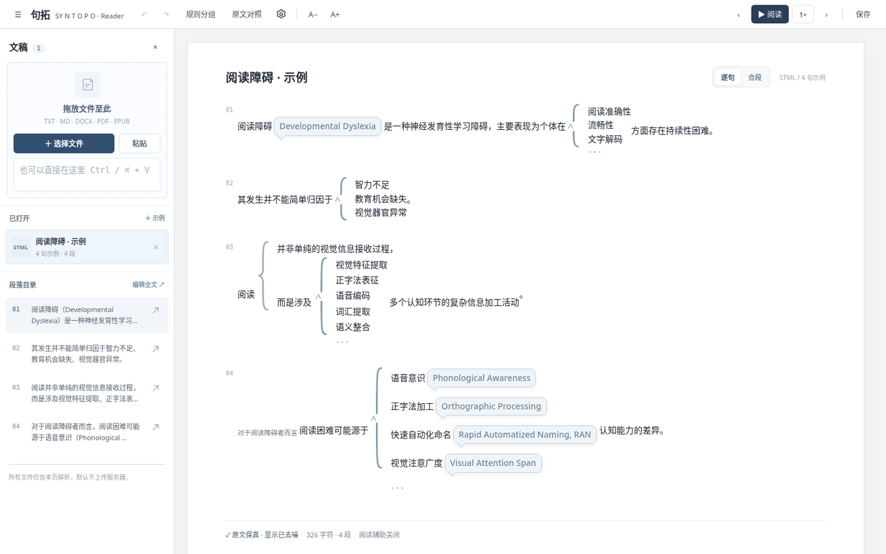
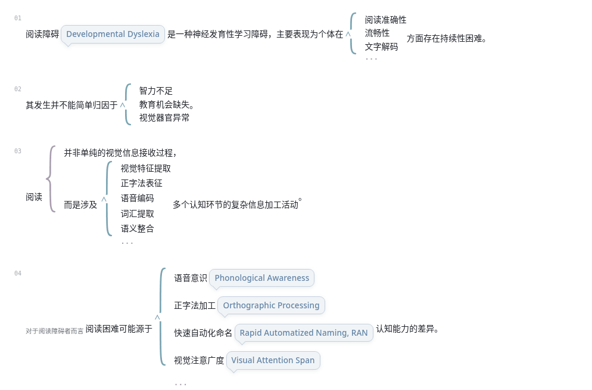
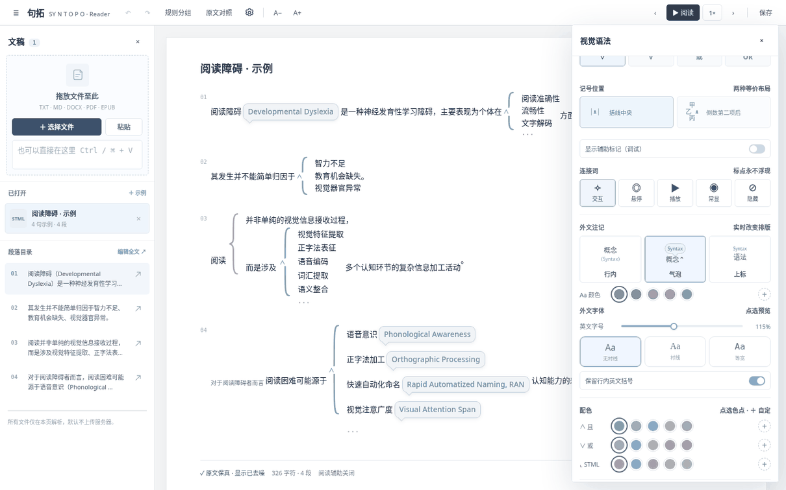
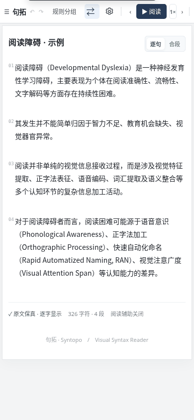

# 句拓 · Syntopo

**把句法关系变成空间关系。**  
*A spatial syntax reader that lets the structure of language be seen.*

**[阅读器源码](./index.html)** · **[反馈与建议](https://github.com/Guzi2005/Syntopo/issues)**

Syntopo（句拓）是一款实验性的**视觉句法阅读器**。它不改变原文，而是将并列、选言、从属、对照等句法关系展现在二维阅读空间里，让读者在文字之外直接看到结构。设计重点是阅读时的**认知负担、信息层级与视线动线**，而不是展示解析器内部标记。

图：v0.31 桌面版实际浏览器截图，示例文本为阅读障碍相关说明；该项目不是医疗诊断工具。

## 01 / 看见句子的层次

**读者看到的是语句与关系，而非标记代码。** 通过柔和的结构括线、`∧`（与）与 `∨`（或），把线性长句展开成并列、择一、嵌套与对位的阅读结构。辅助调试符号默认收起。

## 02 / 随时回到原文

点击工具栏的 **「原文对照」**，语句片段从结构位置平滑归位到原来的文本顺序；反向切换则重新展开。切换保留原文字词及标点，动画采用 ease-in-out 缓动，也尊重系统的“减少动态效果”设置。

## 03 / 按自己的习惯阅读

- **外文注记**：行内、气泡、上标三种模式；中英文标注不应挤占结构括线。
- **阅读引导**：马克笔扫读或细点线，支持句末「等一等」朗读追平机制。
- **结构编辑**：框选片段进行分组或切分，双击原位编辑；可撤销、重做。
- **文稿**：本地选择、拖放或粘贴文本，支持 TXT、Markdown、DOCX、EPUB 和可提取文字的 PDF。
- **视觉设置**：括线样式、符号位置、配色、字形、字号和间距均可调整。

<table>
<tr>
<td width="68%" valign="top"> 视觉语法与注记设置</td>
<td width="32%" valign="top"> 移动端 · 结构阅读（v0.32 截图；v0.33 已升级控制栏）</td>
</tr>
</table>

## 04 / 手机端：阅读优先（v0.33）

手机端现在采用**轻量顶栏 + 固定底部阅读控制**：文稿、原文对照、上一片段、阅读／暂停、下一片段和设置均可单手操作。顶部的「工具」打开底部操作面板，集中编辑全文、规则分组、撤销／重做、字号、速度及导出。设置改为可滚动的底部面板；文字选区与括线的结构菜单靠近底部显示，不再浮在被选中的正文上。

手机屏幕下去除了纸张外框与多余阴影，同时保留原有 STML 结构排版和原文保真机制。移动端仍属于迭代中的实验体验。

## 快速使用

1. **直接体验**：打开仓库根目录的 [`index.html`](./index.html)（一个可独立打开的 HTML 文件）。
2. **导入文稿**：点击左侧 **「选择文件」**，或拖拽文件、粘贴正文。
3. **观察结构**：使用 `∧ / ∨`、括线和从属关系阅读，再点击 **「原文对照」** 验证原文。
4. **调整样式**：点击顶部齿轮，可切换外文呈现方式、阅读模式和 STML 规则说明。

### 手工标记

选中正文可以切分片段并标记「且／或／对位／从属」；双击片段可以修改文字；`Alt` + 拖动可尝试对相邻片段建组。普通拖动优先选择文字。撤销使用 `Ctrl/⌘ + Z`，重做使用 `Ctrl/⌘ + Shift + Z`。

### 项目状态

- **当前阅读器版本：v0.33**。已修复嵌套括线异常留白，并重做移动端控制区、设置与触屏编辑入口。项目仍处于实验迭代阶段。
- **本地优先**：阅读器主体为单文件静态网页；某些格式的文档解析会按需加载第三方浏览器端依赖。扫描版 PDF 不包含 OCR。
- **GitHub Pages**：工作流位于 [`.github/workflows/deploy.yml`](./.github/workflows/deploy.yml)。需先到仓库 **Settings → Pages → Build and deployment** 将 Source 设为 **GitHub Actions**，再确认 Actions 部署成功。不能仅凭仓库公开就认定网站已经上线。
- **版权与授权**：目前尚未发布开源许可证；公开可见不代表自动授予使用、修改及再分发的权利。

---

English summary

**Syntopo** is an experimental visual syntax reader. It spatially lays out conjunctions, alternatives, subordinate phrases, and contrasts while preserving the original text. It offers reversible source/structure transitions, three English-annotation modes, guided reading, and basic manual structure editing. The core is a standalone HTML file (`index.html`). The project is evolving; complex layout and imported formats have limitations.

